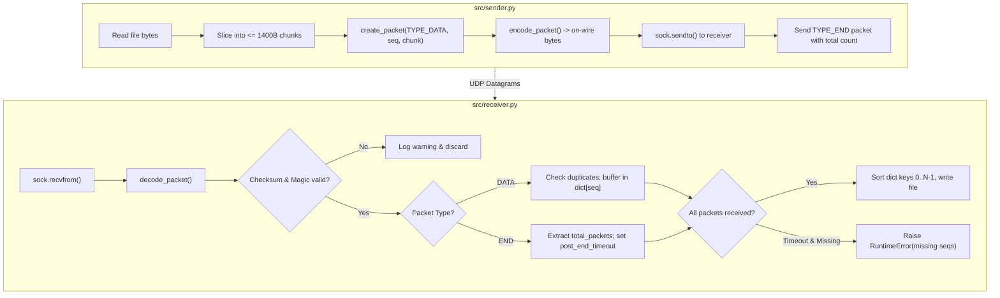

# Nishtha's Learning Guide: UDP Communication & Packet Format

**Module Focus:** `src/packet.py`, `src/sender.py`, `src/receiver.py`  
**Course:** CS-30003 · Coding Assignment 1 — P3: Reliable Data Transfer over UDP  
**Author / Contributor:** Nishtha Bhushan  

---

## 1. Architecture Overview & Component Responsibilities

The current implementation provides the baseline transport and framing layer for file transmission over UDP. It does **not** implement reliability mechanisms (ARQ, ACKs, retransmissions), which are assigned to teammates.



---

## 2. Key Functions & Module Walkthrough

### Module: `src/packet.py`
| Function | Input Parameters | Output | Responsibility & Behavior |
| :--- | :--- | :--- | :--- |
| `_validate_fields` | `packet_type`, `sequence_number`, `timestamp_ns`, `payload` | None (raises on error) | Validates bounds: type in `{1, 2}`, seq in $[0, 2^{32}-1]$, timestamp in $[0, 2^{64}-1]$, payload is bytes and $\le 1400$ bytes. |
| `_checksum_input` | `packet_type`, `sequence_number`, `timestamp_ns`, `payload` | `bytes` | Packs header fields into binary format (without the checksum field) and appends payload. This raw byte sequence is what gets hashed. |
| `create_packet` | `packet_type`, `sequence_number`, `payload=b""`, `timestamp_ns=None` | `Packet` dataclass | Validates inputs and returns a structured `Packet` object in memory. If `timestamp_ns` is omitted, auto-generates using `time.monotonic_ns()`. |
| `encode_packet` | `Packet` object | `bytes` (on-wire datagram) | Computes SHA-256 digest over `_checksum_input`, packs the 52-byte header using `struct.pack("!4sBBIQH32s", ...)`, appends the payload, and returns raw bytes. |
| `decode_packet` | `data: bytes` | `Packet` dataclass | Unpacks the 52-byte header, verifies magic bytes (`AUDP`), protocol version (`1`), packet type, datagram length, recomputes SHA-256 over received data, and verifies with `hmac.compare_digest`. |
| `verify_checksum` | `data: bytes` | `bool` | Convenience helper that runs `decode_packet` inside a `try/except` block and returns `True` if valid, `False` otherwise. |
| `encode_end_payload` | `total_data_packets: int` | `bytes` (4 bytes) | Packs the total number of DATA packets into a 4-byte unsigned big-endian integer (`!I`). |
| `decode_end_payload` | `payload: bytes` | `int` | Unpacks 4 bytes into an integer representing the expected number of DATA packets. |

### Module: `src/sender.py`
| Function | Input Parameters | Output | Responsibility & Behavior |
| :--- | :--- | :--- | :--- |
| `send_file` | `input_path`, `host="127.0.0.1"`, `port=5005`, `packet_interval=0.001` | `dict` (bytes, packets, sha256) | Reads entire file into memory, computes SHA-256 hash, splits into 1400-byte chunks, creates UDP datagrams with incrementing sequence numbers (`seq = 0, 1, ...`), sends via `sock.sendto()`, sleeps for `packet_interval`, and sends a final `TYPE_END` datagram. |

### Module: `src/receiver.py`
| Function | Input Parameters | Output | Responsibility & Behavior |
| :--- | :--- | :--- | :--- |
| `receive_file` | `output_path`, `host`, `port`, `timeout=30.0`, `post_end_timeout=5.0` | `dict` (bytes, packets, duplicates, sha256) | Binds UDP socket, listens for packets, validates checksums, stores unique payloads in `received[seq]`, records duplicates, parses `TYPE_END` payload for expected count, switches to `post_end_timeout` if packets are missing, verifies no gaps exist, and writes ordered file to disk. |

---

## 3. Packet Header Deep Dive

### Header Layout (52 Bytes)

| Offset | Field Name | Type | Size | Endianness | Description |
| :---: | :--- | :---: | :---: | :---: | :--- |
| **0** | Magic Identifier | `char[4]` | 4 B | Big-Endian | Constant ASCII bytes `AUDP` (0x41, 0x55, 0x44, 0x50). Rejects packets from other protocols. |
| **4** | Protocol Version | `uint8` | 1 B | — | Constant `1`. Allows backward compatibility checks if format changes. |
| **5** | Packet Type | `uint8` | 1 B | — | `1 = TYPE_DATA`, `2 = TYPE_END`. |
| **6** | Sequence Number | `uint32` | 4 B | Big-Endian (`!I`) | Zero-based chunk index for `DATA`; total packet count for `END`. Range: $0$ to $2^{32}-1$. |
| **10** | Timestamp | `uint64` | 8 B | Big-Endian (`!Q`) | High-resolution timestamp from `time.monotonic_ns()`. Used for RTT calculation. |
| **18** | Payload Length | `uint16` | 2 B | Big-Endian (`!H`) | Length of trailing payload in bytes ($0$ to $1400$). |
| **20** | SHA-256 Checksum | `bytes[32]` | 32 B | Raw bytes | SHA-256 digest of header fields (offsets 0–19) concatenated with payload. |
| **52** | Payload | `bytes` | $N$ B | Raw bytes | Actual file data chunk ($0 \le N \le 1400$). |

### Struct Format String: `!4sBBIQH32s`
- `!`: Network byte order (Big-Endian). Crucial so that different hardware architectures agree on byte significance.
- `4s`: 4-byte string (`MAGIC`).
- `B`: 1-byte unsigned char (`VERSION`).
- `B`: 1-byte unsigned char (`TYPE`).
- `I`: 4-byte unsigned integer (`sequence_number`).
- `Q`: 8-byte unsigned integer (`timestamp_ns`).
- `H`: 2-byte unsigned short (`payload_length`).
- `32s`: 32-byte binary string (`SHA-256 checksum`).

---

## 4. Transmission, Reassembly & Error Handling Flow

### 1. Handling Out-of-Order Packets
- UDP datagrams may take divergent routes through intermediate routers and arrive out of order (e.g. packet 2 before packet 1).
- **Current Behavior:** The receiver does **not** rely on arrival order. It inserts payloads into a dictionary keyed by sequence number: `received[pkt.sequence_number] = pkt.payload`.
- When all expected packets have arrived, the receiver iterates sequentially:
  ```python
  reconstructed = b"".join(received[seq] for seq in range(expected_packets))
  ```
  This guarantees bit-for-bit reconstruction regardless of arrival sequence.

### 2. Handling Duplicate Packets
- Network anomalies or naive retransmissions can deliver duplicate datagrams.
- **Current Behavior:** Before storing a packet, the receiver checks:
  ```python
  if pkt.sequence_number in received:
      duplicates += 1
      continue
  ```
  The redundant packet is safely dropped without corrupting the assembled file.

### 3. Handling Missing Packets & Post-END Timeout
- If a DATA packet is lost, UDP provides no automatic recovery.
- If the `END` packet arrives before all DATA packets have been delivered:
  1. The receiver reads `expected_packets` from the END payload.
  2. Because `len(received) < expected_packets`, it switches its socket timeout from `timeout` (30s) to `post_end_timeout` (5s).
  3. If delayed packets arrive during this 5s grace period, they are buffered.
  4. If the timer expires and packets are still missing, the receiver reports:
     `RuntimeError: Cannot reconstruct file: X of Y DATA packet(s) missing. Missing sequence numbers: [1, ...]`

### 4. Empty File Handling
- An empty file ($0$ bytes) results in `total_packets = 0`.
- The sender sends no DATA packets, only an END packet with payload `encode_end_payload(0)`.
- The receiver creates an empty destination file ($0$ bytes) and computes the valid SHA-256 hash of an empty byte string.

---

## 5. What the Current Implementation Does NOT Guarantee

Be completely honest about the system's current limitations during the viva:
1. **No Reliability (No Loss Recovery):** If a packet is lost in transit, the transfer will fail with a `RuntimeError`. There are no ACKs or retransmission timers.
2. **No Flow or Congestion Control:** The sender paces transmission using a hardcoded sleep (`packet_interval = 0.001s`), not adaptive rate control or sliding window sizing.
3. **In-Memory Buffering:**
   - `sender.py` reads the entire file into RAM (`path.read_bytes()`).
   - `receiver.py` accumulates all chunks in a dictionary in RAM before writing.
   - For multi-gigabyte files, this would exhaust system memory.
4. **Single Stream Only (No Session / Transfer ID):** There is no session ID in the header. If two clients send to port 5005 simultaneously, their packets will collide and corrupt the stream.

---

## 6. Ten Essential Viva Questions & Model Answers

### Q1: Why did you choose UDP instead of TCP for this project?
**Model Answer:**  
TCP provides reliable, ordered byte-stream delivery with built-in congestion and flow control, but its mechanisms are implemented inside the OS kernel as a black box. The objective of Assignment 1 (Project P3) is to design and evaluate custom transport protocols (Stop-and-Wait, Go-Back-N, Selective Repeat, and adaptive rate control) from scratch. UDP provides raw, un-opinionated datagram access at the socket level, allowing us to build and measure our own transport layer in user space.

### Q2: What does network byte order mean, and why did you use `!` in `struct.pack`?
**Model Answer:**  
Network byte order is Big-Endian, where the most significant byte is stored at the lowest memory address. Host architectures differ: x86 systems are Little-Endian, while some network hardware is Big-Endian. If an x86 sender transmitted a 32-bit integer `1` as `0x01 0x00 0x00 0x00` without formatting, a Big-Endian receiver would interpret it as $16{,}777{,}216$. Using the `!` prefix forces standard Big-Endian serialization across all machines.

### Q3: Why is SHA-256 used instead of a standard 16-bit Internet checksum?
**Model Answer:**  
A 16-bit 1's complement checksum (like in standard UDP/IP) is lightweight but has a higher collision probability ($1 \text{ in } 2^{16}$) and cannot detect certain transposition errors. SHA-256 provides a 256-bit cryptographically secure hash, ensuring an infinitesimal collision probability and detecting both accidental bit flips and deliberate payload tampering. For high-speed production streaming, CRC32 or Fletcher-32 could be used to reduce CPU overhead, but SHA-256 offers absolute integrity verification.

### Q4: Why did you use `hmac.compare_digest` instead of standard `==`?
**Model Answer:**  
Standard string and byte comparison operators (`==`) terminate early on the first mismatched byte. This introduces measurable timing variations (timing side-channels) that allow an attacker to guess valid checksum bytes one by one. `hmac.compare_digest` performs constant-time comparison across the entire 32-byte digest, eliminating timing attacks.

### Q5: How does the receiver know all packets have arrived if UDP doesn't guarantee delivery?
**Model Answer:**  
We designed an in-band signaling mechanism: the `TYPE_END` packet contains the total DATA packet count in both its sequence number field and its payload. When the receiver decodes `END`, it learns the exact count $N$. It then verifies that every sequence number $0, 1, \dots, N-1$ is present in its received dictionary. If any are missing, it waits for a configurable `post_end_timeout` before raising a missing-packet error.

### Q6: What happens if an END packet is lost in the network?
**Model Answer:**  
If the END packet is lost, the receiver will never receive the signal indicating the total expected count. It will remain blocked in its `recvfrom` call until its master socket timeout (30 seconds) expires. Upon timeout, it enters fallback logic: it infers the expected count from the highest sequence number received so far. In the full ARQ protocol to be implemented by Prakhar, the END packet will also be acknowledged and retransmitted if lost.

### Q7: Why is `MAX_PAYLOAD_SIZE` set to 1400 bytes?
**Model Answer:**  
Standard Ethernet networks have a Maximum Transmission Unit (MTU) of 1500 bytes. Subtracting the standard IPv4 header (20 bytes) and UDP header (8 bytes) leaves 1472 bytes for the UDP payload. Our custom packet header is 52 bytes. $1400 + 52 = 1452$ bytes, which leaves 20 bytes of headroom below the 1472-byte limit to prevent IP fragmentation across diverse network paths and tunnel overheads (such as PPPoE or VPNs).

### Q8: How does your receiver differentiate between a new packet and a duplicate?
**Model Answer:**  
Every DATA packet carries a unique `sequence_number`. The receiver maintains a hash table `received: dict[int, bytes]`. When a packet arrives, it evaluates `if pkt.sequence_number in received:`. If `True`, the packet has already been stored; the receiver increments a duplicate counter and discards the datagram without processing it further.

### Q9: Could an attacker forge an END packet to truncate the file early?
**Model Answer:**  
If an attacker sends an invalid END packet, our checksum verification will reject it if they cannot compute the SHA-256 digest. However, on an unsecured network without authentication keys, an attacker who crafts a valid checksum could send an END packet. Even if this occurs, the receiver checks whether all sequence numbers $0 \dots N-1$ are present. If the attacker claims $N=10$ but only 5 packets arrived, the receiver will detect the missing sequence numbers and fail rather than writing a truncated file.

### Q10: How can your packet format accommodate ACKs for Prakhar's ARQ module?
**Model Answer:**  
We can define `TYPE_ACK = 3` in `packet.py`. For Stop-and-Wait and basic Go-Back-N, the `sequence_number` field in the header can directly carry the cumulative ACK number, requiring 0 payload bytes. For Selective Repeat, the ACK payload can contain a 32-bit or 64-bit bitmask representing which subsequent packets within the window have been received.

---

## 7. Practical Exercises for Nishtha to Solve

To prepare for live coding during the viva, complete these exercises independently:

### Exercise 1: Write a Standalone Datagram Encoder
Without looking at `src/packet.py`, write a 15-line Python script that uses `struct.pack("!4sBBI", ...)` to encode a magic string `b"AUDP"`, version `1`, type `1`, sequence `42`, and a custom text message. Print the hex representation of the encoded bytes.

### Exercise 2: Manually Corrupt a Checksum
Write a small test script that takes a valid encoded packet from `encode_packet`, flips the last byte with `data[:-1] + bytes([data[-1] ^ 0x01])`, passes it to `decode_packet`, and verifies that it raises `PacketError`.

### Exercise 3: Add an ACK Packet Type
Open a scratch copy of `packet.py`:
1. Define `TYPE_ACK = 3`.
2. Add `TYPE_ACK` to `_VALID_TYPES`.
3. Create a helper function `create_ack_packet(ack_seq)` that returns a `Packet` with `packet_type=TYPE_ACK`, `sequence_number=ack_seq`, and an empty payload.
4. Verify that `encode_packet` and `decode_packet` round-trip correctly for your new ACK packet.
