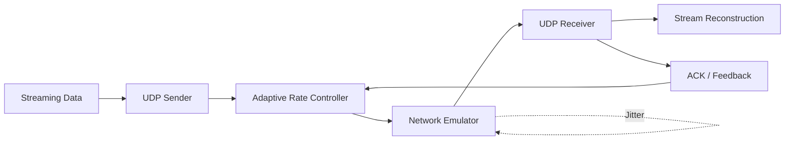

<div align="center">

# 🚀 Adaptive UDP Streaming
An adaptive UDP-based streaming protocol designed for reliable and efficient real-time data delivery under varying network conditions. The project implements custom packet handling, acknowledgements, retransmission, RTT/jitter measurement, adaptive transmission-rate control, and a network emulator for performance evaluation.
### Adaptive Transport Protocol for Real-Time Streaming over UDP

<p>
  
  
  
  
</p>

</div>

---

## 📌 Overview

**Adaptive UDP Streaming** is a custom transport mechanism designed for
reliable and efficient real-time data delivery over UDP.

The protocol monitors network conditions such as **packet loss, RTT and
jitter** and dynamically adjusts the transmission rate.

A custom **network emulator** is used to introduce controlled loss,
delay and jitter for evaluating the protocol under different network
conditions.

> **Core idea:** Adapt the transmission rate according to network
> conditions instead of using a fixed transmission rate.

---

## 🧭 Course Context (CS-30003 · Coding Assignment 1)

| | |
|---|---|
| **Track** | **Path B** — own proposal (not a catalogue project) |
| **Mechanism implemented** | A custom transport protocol over UDP: framing, ACKs, retransmission, RTT/RTO estimation, and adaptive rate control |
| **Level** | Socket level (`socket` API only; no transport/streaming libraries) |
| **Falsifiable claim** | Adaptive transmission gives higher, more stable goodput than fixed-rate UDP under varying loss, delay and jitter |
| **Method** | Controlled network emulator (seeded, reproducible); compare adaptive vs fixed-rate on goodput, retransmissions, latency and jitter; plot and analyse results |

Assignment rules followed here: sockets only, one shared repository, every member commits under their own name, and AI usage disclosed in `AI-USE.md`.

---

## 🎯 Objectives

- Implement UDP communication using sockets.
- Design a custom packet format with sequence numbers and checksums.
- Implement acknowledgements and retransmission.
- Measure RTT and network jitter.
- Develop adaptive transmission-rate control.
- Build a configurable network emulator.
- Reconstruct and verify the received stream.
- Compare adaptive and fixed-rate UDP transmission.

---

## 🏗️ System Architecture



### Data Flow

```text
Streaming Data
      ↓
 UDP Sender
      ↓
Packet Formation
      ↓
Adaptive Rate Control
      ↓
Network Emulator
      ↓
 UDP Receiver
      ↓
Stream Reconstruction
      ↓
Received Data
```

---

## ⚙️ Core Components

<details open>
<summary><b>1. Packet Format</b> — <code>src/packet.py</code> ✅</summary>

Implemented by **Nishtha Bhushan**.

Custom versioned binary protocol (AUDP v1) with network byte order:

| Offset | Size | Field |
|--------|------|-------|
| 0 | 4 | Magic bytes (`AUDP`) |
| 4 | 1 | Protocol version (1) |
| 5 | 1 | Packet type (1=DATA, 2=END) |
| 6 | 4 | Sequence number (uint32) |
| 10 | 8 | Monotonic timestamp (uint64, nanoseconds) |
| 18 | 2 | Payload length (uint16) |
| 20 | 32 | SHA-256 checksum |
| 52 | N | Payload (0–1400 bytes) |

**Features:** SHA-256 checksum (timing-safe validation via `hmac.compare_digest`), DATA and END packet types, sequence numbers, configurable max payload (1400 bytes), encode/decode round-trip, clear `PacketError` exceptions.

</details>

<details open>
<summary><b>2. UDP Sender</b> — <code>src/sender.py</code> ✅</summary>

Implemented by **Nishtha Bhushan**.

Reads a file, splits it into sequenced DATA packets, and sends them over UDP with configurable pacing. The END packet embeds the total DATA-packet count so the receiver can verify completeness.

```bash
python -m src.sender path/to/file.bin --host 127.0.0.1 --port 5005 --interval 0.001
```

**Features:** Chunked file transmission, SHA-256 file-hash logging, empty-file support, configurable pacing, input validation, structured logging.

> **Note:** Retransmission is provided by the reliability layer (see below). Adaptive rate control is not implemented yet — it is assigned to Subham.

</details>

<details open>
<summary><b>3. UDP Receiver</b> — <code>src/receiver.py</code> ✅</summary>

Implemented by **Nishtha Bhushan**.

Listens on a UDP socket, decodes and validates packets, tracks sequence numbers, handles duplicates, reassembles the stream in order, and detects missing packets.

```bash
python -m src.receiver --host 127.0.0.1 --port 5005 --output received.bin --timeout 30 --post-end-timeout 5
```

**Features:** Post-END timeout for late-arriving DATA packets, duplicate detection, out-of-order reassembly, missing-packet reporting, SHA-256 output hash, safe file writing.

> **Limitation:** UDP does not guarantee delivery. If END arrives before delayed DATA packets, the receiver waits up to `--post-end-timeout` seconds for stragglers. If packets are still missing, the transfer fails with a clear error listing the missing sequence numbers.

</details>

<details open>
<summary><b>4. Reliability Mechanism</b> — <code>src/reliability.py</code> ✅</summary>

Implemented by **Prakhar Manish Srivastava**.

Stop-and-Wait ARQ with ACK packets (type 3). Socket-independent building blocks:

- `RttEstimator` — Jacobson/Karels SRTT/RTTVAR/RTO (RFC 6298), Karn's algorithm (retransmitted packets give no RTT sample), exponential backoff, configurable min/max RTO.
- `StopAndWaitARQ` — sender state: one packet in flight, matching-ACK validation, timeout detection, retry limit (`MaxRetriesExceededError`).
- `StopAndWaitReceiver` — receiver state: sequence progression and duplicate re-ACK; never ACKs seq 0 before it arrives.

The sender (`--arq stop-and-wait`, default) retransmits on timeout and also waits for an ACK of the END packet. The receiver lingers briefly after completion to re-ACK a lost END ACK. `--arq none` keeps the original fire-and-forget behaviour.

</details>

<details>
<summary><b>5. Network Emulator</b> — <code>src/emulator.py</code> ✅</summary>

Implemented by **Subham Kumar Sahu**.

A UDP relay between sender and receiver that introduces seeded, reproducible impairments:

- Packet loss
- Delay
- Jitter

`experiments/bottleneck_link.py` adds a bandwidth-limited link with a finite queue on top of it (see `docs/bandwidth_emulator_plan.md`).
Review notes: `docs/emulator_review.md`.

</details>

<details>
<summary><b>6. Adaptive Rate Control</b> — <code>src/rate_control.py</code>, <code>src/paced_sender.py</code> ✅</summary>

Implemented by **Subham Kumar Sahu**.

The paced sender uses measured packet loss, RTT and jitter to adjust its transmission rate (AIMD), and has a fixed-rate
mode as the baseline. The receiver acknowledges each packet in `selective` mode for it. Wire format and behaviour of
every module: `docs/protocol_design.md`.

</details>

---

## 🧪 Experiments

Every experiment is seeded, repeated and written to a JSON file in `results/`. The dashboard reads the newest file
from disk, so it always shows the latest recorded report.

| Script | What it measures | Output |
|---|---|---|
| `experiments/run_repeats.py` | Fixed vs. adaptive under random loss, delay and jitter (E1–E4), 5 seeded repeats | `results/experiment_repeats.json` |
| `experiments/run_tuned.py` | Same, after searching the controller's thresholds on held-out seeds | `results/experiment_tuned.json` |
| `experiments/run_bottleneck.py` | Fixed vs. adaptive over a bandwidth-limited link with a finite queue, plus a fixed-rate sweep | `results/experiment_bottleneck.json` |
| `experiments/run_bottleneck_tuned.py` | Controller tuning on the bottleneck link | `results/experiment_bottleneck_tuned.json` |

Run them from the repository root, for example `python -m experiments.run_repeats`. The bandwidth-limited link lives in `experiments/bottleneck_link.py` (it extends the emulator
classes without editing `src/emulator.py`); the design is in `docs/bandwidth_emulator_plan.md`.

### Method

- Same payload and same seeds for both modes, so each pair sees identical network behaviour.
- Controller settings are chosen on tuning seeds (101–103) and reported on separate seeds (1–5).
- Every configuration tried is kept in the result file and shown on the dashboard, including those that did worse.
- Metrics: goodput, round-trip time, jitter, retransmissions, SHA-256 integrity.

### Where the claim stands

> **Claim:** adaptive transmission gives better and more stable performance than fixed-rate UDP under varying conditions.

- With random loss only, the emulator has no capacity limit, so slowing down cannot reduce loss; adaptive control has little to gain there.
- On the bandwidth-limited link (100 KB transfers, seeds 1-5), tuning the controller roughly doubled its goodput versus the
  default settings, but it still sends fewer bits per second than the fixed 200 packets/s baseline.
- Where the link is congested (1000 and 500 kbps), adaptive had no retransmissions and about half the delay, and it delivered
  the file intact where fixed 200 pps overran the queue and, at 500 kbps, failed the integrity check.
- So the evidence so far supports the claim for delay, retransmissions and reliability under congestion, and does not support
  it for raw goodput on short transfers. Longer transfers are the next experiment, since the controller's start-up cost is
  spread over fewer packets in a 100 KB file.
- The report is the measured data, not a conclusion written in advance. See the dashboard's Experiments page.

---

## 🛠️ Technology Stack

| Technology | Purpose |
|---|---|
| **Python** | Core implementation, test server, experiments |
| `socket` | UDP communication |
| `threading` | Concurrent operations |
| `time` | Timing and RTT measurement |
| `hashlib` | Data integrity verification |
| `http.server` | Local test server (standard library only) |
| HTML, CSS, JavaScript (ES modules) | Responsive dashboard, no build step |

The core networking mechanism is implemented using socket-level
communication rather than an existing library that provides the required
protocol functionality.

---

## 📁 Project Structure

```text
adaptive-udp-streaming/
│
├── src/                  # Protocol core (library + CLI)
│   ├── packet.py         #   AUDP wire format
│   ├── reliability.py    #   RTT estimator, Stop-and-Wait ARQ
│   ├── sender.py         #   file → UDP sender (CLI)
│   ├── receiver.py       #   UDP receiver → file (CLI)
│   ├── paced_sender.py   #   rate-paced sender with adaptive or fixed mode
│   ├── rate_control.py   #   AIMD adaptive rate controller
│   └── emulator.py       #   network emulator and UDP relay
│
├── backend/              # Local test server (Python standard library only)
│   ├── service.py        #   loopback transfers, sample files, results loader, run log
│   └── server.py         #   JSON API + static file server
│
├── frontend/             # Responsive dashboard (static, no build step)
│   ├── index.html, styles.css
│   ├── js/               #   app.js (router, views), data.js, charts.js
│   └── data/team.json    #   credits text
│
├── experiments/          # Experiment runners and the bottleneck link
├── results/              # Recorded reports (JSON); transfer_log.jsonl is local only
├── docs/                 # Protocol design, emulator review, bandwidth-limited link plan, status
├── tests/                # pytest suite (protocol, reliability, emulator, backend, bottleneck, repo health)
├── .github/workflows/    # CI, automatic merge into development, manual promotion to main
├── AI-USE.md             # Disclosure of AI assistance
└── requirements.txt
```

### Layering

```text
frontend/ (browser)  ──HTTP/JSON──▶  backend/  ──imports──▶  src/ (protocol core)
                                         │
                                         └── reads results/*.json, appends results/transfer_log.jsonl
```

`src/` has no knowledge of the web layer, so the CLI tools and the tests work without it.

---

## 🖥️ Run the Local Test Server

```bash
pip install -r requirements.txt
python -m backend.server --port 8080
```

Open <http://127.0.0.1:8080>. Pages:

| Page | Shows |
|---|---|
| **Overview** | Latest experiment report (charts and condition cards), plus a live summary of local loopback runs |
| **Experiments** | RTT, jitter, retransmission and send-rate charts, raw table, controller tuning and fixed-rate sweep when present |
| **Protocol** | Header layout, packet types, reliability rules |
| **Run** | Send a predefined sample file (or your own, up to 2 MB) over UDP on this machine and verify it by SHA-256 |
| **Credits** | Each member's contributions and a project summary |

**Live data.** Nothing on the dashboard is typed into the page. The server reads the newest file in `results/` on every
request, and the page checks again every 8 seconds. Each loopback run is appended to `results/transfer_log.jsonl`, so the
Overview's live summary survives restarts and updates as soon as a run finishes.

| Endpoint | Description |
|---|---|
| `GET /api/results` | Newest experiment report from `results/` (`source`, `modified`, `data`) |
| `GET /api/samples` | Predefined test files (empty, note, boundary, article, log, pattern, random) |
| `GET /api/history` | Recent loopback runs, newest first (from the run log) |
| `GET /api/info` | Protocol constants and upload limit |
| `POST /api/transfer?sample=<id>&arq=&interval=&max_retries=&initial_rto=` | Run a transfer with a predefined file (or send a raw body with `?filename=`) |

> Loopback never drops packets, so retransmissions in live runs are normally 0. Loss, delay and bandwidth limits come from the experiment scripts.

### Command-line (two terminals)

```bash
python -m src.receiver --port 5005 --output received.bin
python -m src.sender test_data/sample.txt --port 5005
```

---

## 👥 Team

| Member | GitHub | Responsibility |
|---|---|---|
| **Nishtha Bhushan** | [@nish1ha-ux](https://github.com/nish1ha-ux) | UDP communication & packet format (`src/packet.py`, `src/sender.py`, `src/receiver.py`) |
| **Prakhar Manish Srivastava** | — | ACK, retransmission & RTT (`src/reliability.py`) |
| **Subham Kumar Sahu** | [@subhamkumarsahu929](https://github.com/subhamkumarsahu929) | Adaptive rate control & network emulator (branch `feature/rate-control-and-emulator`) |
| **Sudhanshu Aryan** | — | Testing, experiments & analysis |

Credit for each component follows the commit history of this repository.

---

## 📅 Development Plan

| Week | Target |
|---|---|
| 1 | Project design |
| 2 | Packet handling & streaming |
| 3 | ACK & retransmission |
| 4 | Network emulator |
| 5 | Adaptive mechanism |
| 6 | Integration & testing |
| 7 | Experiments & graphs |
| 8 | Finalization & viva |

---

## 🔀 Branches and CI

| Branch | Purpose |
|---|---|
| `development` | Where everyone's work lands. Kept up to date automatically. |
| `main` | Stable. Updated only by a manual pull request from `development`. |
| `feature/*` | Each member's own work. Open a pull request into `development`. |

1. Push a branch and open a pull request into `development`.
2. The `Auto-merge into development` workflow runs the full test suite.
3. If the tests pass and the branch merges cleanly, it is merged automatically with a merge commit, so each author's
   commits keep their own name. If there is a conflict or a failing test, the pull request stays open and the workflow
   comments; fix it and push, and it runs again.
4. To release, run the `Open promotion pull request` workflow (or open the pull request by hand), review it, and merge it.
   Nothing merges into `main` automatically.

The `CI` workflow also runs the tests on every push to `development` and on pull requests into `main`.

---

## 🧪 Running Tests

```bash
pip install -r requirements.txt
python -m pytest tests/ -v
```

- **Packet tests** (`test_packet.py`): round-trips, checksums, malformed or truncated data, ACK rules, END payload.
- **Transfer tests** (`test_udp_transfer.py`): multi-packet, single-packet, empty and boundary files, SHA-256 integrity, duplicates, out-of-order data, timeouts.
- **Reliability tests** (`test_reliability.py`, `test_arq_transfer.py`): RTT/RTO maths, Karn's algorithm, back-off, retry limits, lost data and ACKs.
- **Backend tests** (`test_backend.py`): parameter validation, sample files, transfer API, results loader (newest file wins), run-log persistence, static serving and path-traversal protection.
- **Emulator and rate-control tests** (`test_emulator.py`, `test_rate_control.py`, `test_integration.py`): impairments, AIMD rules, end-to-end transfers through the relay.
- **Bottleneck tests** (`test_bottleneck_link.py`): the bandwidth-limited queue model.
- **Repository health** (`test_repo_health.py`): no conflict markers, every `src` module imports, workflows present.

---

## 🚧 Project Status

- [x] UDP communication and custom packet format
- [x] Reliability: ACKs, retransmission, RTT/RTO (Stop-and-Wait ARQ)
- [x] Local test server and responsive dashboard with live results and run log
- [x] Experiment runners, seeded repeats and held-out tuning
- [x] Bandwidth-limited link for a fair adaptive-vs-fixed test
- [x] Emulator, rate control and paced sender merged into `development`
- [x] Controller tuned on the bottleneck link (results on the dashboard)
- [x] Protocol design and emulator review documents
- [x] CI and automatic merge into `development`
- [ ] Longer-transfer experiments (1 MB or more)
- [ ] Final written analysis and graphs (owner: Sudhanshu Aryan)
- [ ] Promotion of `development` to `main` (manual)

---

<div align="center">

### CS-30003 · Coding Assignment 1

**Adaptive Transport Protocol for Real-Time Streaming over UDP**

</div>
