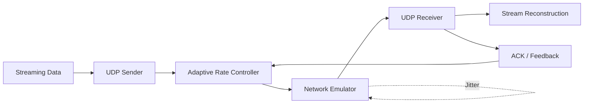

<div align="center">

# 🚀 Adaptive UDP Streaming
An adaptive UDP-based streaming protocol designed for reliable and efficient real-time data delivery under varying network conditions. The project implements custom packet handling, acknowledgements, retransmission, RTT/jitter measurement, adaptive transmission-rate control, and a network emulator for performance evaluation.
### Adaptive Transport Protocol for Real-Time Streaming over UDP

<p>
  
  
  
  
</p>

</div>

---

## 📌 Overview

**Adaptive UDP Streaming** is a custom transport mechanism designed for
reliable and efficient real-time data delivery over UDP.

The protocol monitors network conditions such as **packet loss, RTT and
jitter** and dynamically adjusts the transmission rate.

A custom **network emulator** is used to introduce controlled loss,
delay and jitter for evaluating the protocol under different network
conditions.

> **Core idea:** Adapt the transmission rate according to network
> conditions instead of using a fixed transmission rate.

---

## 🎯 Objectives

- Implement UDP communication using sockets.
- Design a custom packet format with sequence numbers and checksums.
- Implement acknowledgements and retransmission.
- Measure RTT and network jitter.
- Develop adaptive transmission-rate control.
- Build a configurable network emulator.
- Reconstruct and verify the received stream.
- Compare adaptive and fixed-rate UDP transmission.

---

## 🏗️ System Architecture



### Data Flow

```text
Streaming Data
      ↓
 UDP Sender
      ↓
Packet Formation
      ↓
Adaptive Rate Control
      ↓
Network Emulator
      ↓
 UDP Receiver
      ↓
Stream Reconstruction
      ↓
Received Data
```

---

## ⚙️ Core Components

<details open>
<summary><b>1. Packet Format</b> — <code>src/packet.py</code> ✅</summary>

Implemented by **Nishtha Bhushan**.

Custom versioned binary protocol (AUDP v1) with network byte order:

| Offset | Size | Field |
|--------|------|-------|
| 0 | 4 | Magic bytes (`AUDP`) |
| 4 | 1 | Protocol version (1) |
| 5 | 1 | Packet type (1=DATA, 2=END) |
| 6 | 4 | Sequence number (uint32) |
| 10 | 8 | Monotonic timestamp (uint64, nanoseconds) |
| 18 | 2 | Payload length (uint16) |
| 20 | 32 | SHA-256 checksum |
| 52 | N | Payload (0–1400 bytes) |

**Features:** SHA-256 checksum (timing-safe validation via `hmac.compare_digest`), DATA and END packet types, sequence numbers, configurable max payload (1400 bytes), encode/decode round-trip, clear `PacketError` exceptions.

</details>

<details open>
<summary><b>2. UDP Sender</b> — <code>src/sender.py</code> ✅</summary>

Implemented by **Nishtha Bhushan**.

Reads a file, splits it into sequenced DATA packets, and sends them over UDP with configurable pacing. The END packet embeds the total DATA-packet count so the receiver can verify completeness.

```bash
python -m src.sender path/to/file.bin --host 127.0.0.1 --port 5005 --interval 0.001
```

**Features:** Chunked file transmission, SHA-256 file-hash logging, empty-file support, configurable pacing, input validation, structured logging.

> **Note:** Adaptive rate control and retransmission are *not* implemented here — they are assigned to Subham and Prakhar respectively.

</details>

<details open>
<summary><b>3. UDP Receiver</b> — <code>src/receiver.py</code> ✅</summary>

Implemented by **Nishtha Bhushan**.

Listens on a UDP socket, decodes and validates packets, tracks sequence numbers, handles duplicates, reassembles the stream in order, and detects missing packets.

```bash
python -m src.receiver --host 127.0.0.1 --port 5005 --output received.bin --timeout 30 --post-end-timeout 5
```

**Features:** Post-END timeout for late-arriving DATA packets, duplicate detection, out-of-order reassembly, missing-packet reporting, SHA-256 output hash, safe file writing.

> **Limitation:** UDP does not guarantee delivery. If END arrives before delayed DATA packets, the receiver waits up to `--post-end-timeout` seconds for stragglers. If packets are still missing, the transfer fails with a clear error listing the missing sequence numbers.

</details>

<details>
<summary><b>4. Reliability Mechanism</b> — <i>Planned</i></summary>

Assigned to **Prakhar Manish Srivastava**.

Acknowledgements and retransmissions will be used to detect and recover
from packet loss.

</details>

<details>
<summary><b>5. Network Emulator</b> — <i>Planned</i></summary>

Assigned to **Subham Kumar Sahu**.

The emulator will introduce controlled network impairments:

- Packet loss
- Delay
- Jitter

</details>

<details>
<summary><b>6. Adaptive Rate Control</b> — <i>Planned</i></summary>

Assigned to **Subham Kumar Sahu**.

The sender will use measured network conditions such as packet loss,
RTT and jitter to adjust its transmission rate.

</details>

---

## 🧪 Experiments

The protocol will be evaluated under different network conditions.

### Variables

| Variable | Description |
|---|---|
| Packet Loss | Percentage of packets intentionally dropped |
| Delay | Artificial network delay |
| Jitter | Variation in packet delay |
| Transmission Rate | Sender's data transmission rate |

### Performance Metrics

| Metric | Purpose |
|---|---|
| **Goodput** | Effective successfully delivered data |
| **Packet Loss** | Percentage of packets lost |
| **Latency** | End-to-end delivery delay |
| **Jitter** | Variation in packet delay |
| **Retransmissions** | Number of packets retransmitted |

### Experimental Claim

> **Adaptive transmission will provide better and more stable streaming
> performance than fixed-rate UDP under varying network conditions.**

Results will be presented using graphs and comparative analysis.

---

## 🛠️ Technology Stack

| Technology | Purpose |
|---|---|
| **Python** | Core implementation |
| `socket` | UDP communication |
| `threading` | Concurrent operations |
| `time` | Timing and RTT measurement |
| `hashlib` | Data integrity verification |
| `matplotlib` | Performance visualization |

The core networking mechanism is implemented using socket-level
communication rather than an existing library that provides the required
protocol functionality.

---

## 📁 Project Structure

```text
adaptive-udp-streaming/
│
├── src/
│   ├── sender.py
│   ├── receiver.py
│   ├── packet.py
│   ├── reliability.py
│   ├── rate_control.py
│   └── emulator.py
│
├── tests/
│
├── experiments/
│
├── results/
│
├── docs/
│
├── requirements.txt
├── README.md
└── AI-USE.md
```

> The project structure will evolve as implementation progresses.

---

## 👥 Team

| Member | Responsibility |
|---|---|
| **Nishtha Bhushan** | UDP communication & packet format |
| **Prakhar Manish Srivastava** | ACK, retransmission & RTT |
| **Subham Kumar Sahu** | Adaptive rate control & network emulator |
| **Sudhanshu Aryan** | Testing, experiments & analysis |

---

## 📅 Development Plan

| Week | Target |
|---|---|
| 1 | Project design |
| 2 | Packet handling & streaming |
| 3 | ACK & retransmission |
| 4 | Network emulator |
| 5 | Adaptive mechanism |
| 6 | Integration & testing |
| 7 | Experiments & graphs |
| 8 | Finalization & viva |

---

## 🧪 Running Tests

Install dependencies and run the test suite:

```bash
pip install -r requirements.txt
python -m pytest tests/ -v
```

Test coverage includes:

- **30 packet tests** — round-trips, checksums, malformed/truncated data, unsupported types, oversized payloads, input validation, END-payload encoding.
- **10 transfer tests** — multi-packet, single-packet, empty-file, exact-boundary transfers, SHA-256 integrity verification, duplicate detection, out-of-order reassembly, timeout behavior, missing-packet detection, sender input validation.

---

## 🚧 Project Status

**Current Status:** 🟡 In Development

- [x] UDP communication
- [x] Custom packet format
- [ ] Reliability mechanism
- [ ] RTT measurement
- [ ] Network emulator
- [ ] Adaptive rate control
- [x] Testing (packet & transfer)
- [ ] Performance experiments
- [ ] Final documentation

---

<div align="center">

### CS-30003 · Coding Assignment 1

**Adaptive Transport Protocol for Real-Time Streaming over UDP**

</div>
